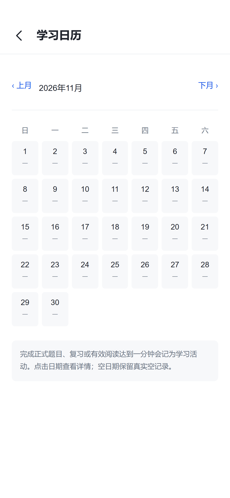

# 离线个人学习闭环验收记录

日期：2026-11-03。分支：`codex/offline-learning-completion`。基线：`ad547a4`。

## 交付范围

按已确认的[设计](../superpowers/specs/2026-11-03-offline-learning-design.md)和[实施计划](../superpowers/plans/2026-11-03-offline-learning-implementation.md)完成离线首期。应用共 69 个已注册页面，在原 17 页之外增加 52 页。静态导航链接核查未发现未注册目标。

新增流程包括收藏/字单/斩字管理、独立专项与结果、复习中心与错题详情、学习日历/每日会话/报告/课程覆盖、识字样本测评、图书管理/书签/摘录笔记、导入及词语/句子/文章检索、消息/前台提醒/日历导出、头像/资料码/资源恢复、备份预览与快照回退、缓存/隐私/帮助/反馈，以及 H5 生产版离线准备。

完整字库为 8105 个唯一汉字：一级 3500、二级 3000、三级 1605；保留原一级 ID、351 关与部首关卡。来源、版本、哈希与许可见[字库来源](../../src/data/character-table/SOURCES.md)。无可靠来源的字段仍标记未收录。

## 既有界面保护

- 对基线中全部 52 个 Vue 文件提取 `<style>` 块逐一比较，差异为 **0**。
- 原 17 个页面分别检查 320、390、430px，共 51 个视口组合，未发现文档横向溢出。
- 既有模板只接真实数据、导航和必要的功能属性；未添加旧模块的新统计区、工具栏或 tab。
- 短横屏阅读菜单在覆盖首行答案时，使用原滚动容器限制高度；回到竖屏恢复。菜单测量与分页分离，关闭菜单后可立即使用键盘揭示及翻页。

以下保留实际页面样例。它们用于检查布局及功能状态；没有声称与含旧占位数据的历史截图逐像素相同。

| 现有首页 | 字单详情 |
| --- | --- |
|  |  |

| 学习日历 | 数据与隐私 |
| --- | --- |
|  |  |

## 验证结果

环境：Windows、Node 24.22.2、pnpm 11、Chrome 手机视口；沿用项目锁文件，没有添加依赖或升级框架。用户其他项目所需的全局 Node 14 未改动。

| 检查 | 结果与范围 |
| --- | --- |
| `pnpm type-check` | 退出 0 |
| `pnpm test` | 57 个文件，**218/218** 通过 |
| `pnpm build:h5` | 审阅修复后的最终产物，退出 0 |
| `pnpm build:app` | 审阅修复后的最终 App-vue 产物，退出 0 |
| 全量浏览器场景 | 执行 183 项；首轮 177 通过，6 项修复/复查后全部通过，无保留失败 |
| 审阅修复后的相关浏览器回归 | **16/16**，含新增加的午夜切日及仅书名命中两个场景 |
| 键盘与日常题序复查 | **2/2** |
| 740×360 横屏及切回竖屏 | **1/1** |
| 最终生产版离线测试 | **1/1**：在线准备→缓存 TXT→失败更新保留旧缓存→断网刷新/新标签页→学习及阅读→清缓存保留数据库 |

浏览器验证采用全量运行加失败项复查，再对审阅修改执行相关回归；没有把修复前失败的首轮报告写成一次性全绿。截图写入冲突通过改用每个测试的输出目录解决，保留原截图基线。旧测试中不再符合实际的字体、占位计数、3500 字总量、隐藏题型标题、题序、滚动容器及按钮名称均改为可观察的真实行为，未修改产品样式来迎合测试。

## 独立审阅与修复

一次独立只读审阅覆盖 `ad547a4..f592036`，无已验证 Critical 或 Minor，提出四项 Important，均由执行者编写失败测试后修复：

1. **并发导出不一致**：新增数据库级多表快照；H5 使用一个只读事务，SQLite 使用串行读事务，恢复前快照复用同一保证。交错写入测试 RED→GREEN，原生桥接并发快照亦通过。
2. **午夜题单变空**：切日协调重读课程、题型与当日题单。正确作答立即记录事实，原有 400ms 反馈保留，反馈跨午夜不会改变答题归属日。单元与浏览器午夜用例通过。
3. **损坏专项可恢复**：校验活动/完成游标、题序、题型及题目完成状态。异常数据在覆盖前拒绝；刚答对尚未前进和完整结束的正常会话均能备份恢复。
4. **文章漏检书名**：标题与正文合并检索并按书去重，标题命中进入有效图书详情，不伪造正文命中。分页和浏览器跳转通过。

此外修复日常连续答错清除已完成题型历史、二三级目录仍提示筹备中，以及原生 JS 缺少 `atob`/`TextEncoder` 时头像和备份预览失败。相关回归均已纳入测试。

## 实施取舍与代价

以下按执行账本中的决定顺序整理；完整原始记录见[执行账本](2026-11-03-offline-learning-execution.md)。

| 决定 | 原因 | 代价或未覆盖部分 |
| --- | --- | --- |
| 沿用已建立的专用分支和当前工作目录 | 用户已授权在此分支自行实现、测试及提交 | 没有另建 worktree；需继续保护共享目录里的其他改动 |
| 检查进程临时使用经校验的 Node 24 | Node 22 的 SQLite NUL 文本读取差异；全局 Node 14 属于另一项目 | 数据库测试以 Node 24 为验收环境，不修改全局运行时 |
| 专项固定题单、选项、题型，单独存储 | 可恢复、幂等、与正式学习隔离 | 修改来源字单不会改写已有专项 |
| 复习来源单独记录，旧来源视为关卡 | 保留原关卡复习规则及入口 | 旧累计错误无精确时间时只能显示历史累计 |
| 新用户一级课程，老用户保留 daily 204；计划次日生效 | 保留老进度与当日会话稳定性 | 当天题单不因设置变更立即替换 |
| 内置资料固定，自定义资料可管理 | 不破坏安装包资源和原阅读入口 | 内置图书不能通过管理页重命名或删除 |
| 全文索引是可重建缓存，不进备份 | 原文为事实来源，避免恢复后旧索引命中 | 清理或恢复后首次检索需重建；App 缺文件选择器时使用粘贴或备份路径 |
| 字库使用固定公开快照，缺字段保持未收录 | 可复现、有来源，不编造字典内容 | 部分释义为标注来源的英文；未逐字人工校验或补造字形 |
| 前台提醒加 ICS，未启用系统后台定时通知 | 未验证可靠的持久系统调度能力 | 应用关闭后不承诺提醒；外部日历事件需在日历应用管理 |
| 新增相机、图库、扫码模块，使用随机本机档案 ID | 接通原头像和扫码入口，避免固定演示值 | 原生权限及设备行为需真机验证；不读取硬件 ID 或查询 IP 属地 |
| 备份先校验关系与内容，App 字体路径保留但不迁移文件 | 避免损坏输入覆盖数据和危险字体资源 | 换机仍需另存 App 字体原文件；反馈仅本地保存及手动导出 |
| 离线新版本完整准备后激活，保留旧版本直到手动清理 | 下载失败仍能使用旧版本和已打开标签页 | 多个版本会占额外空间；仅 HTTPS/localhost 支持 H5 离线启动，浏览器仍可能回收缓存 |
| 原界面样式冻结，修复逻辑和数据绑定 | 遵守用户明确约束 | 原界面的视觉选择不在本次重做范围；截图里的真实值会与旧占位文本不同 |
| 测试等待真实数据就绪、截图按测试隔离 | 完整字库初始化与文件占用使旧检查不稳定 | 首次测试等待时间增加，截图位置改为测试输出目录，断言保留 |
| 本地分支保留，不自动推送或合并 | 用户只授权新分支提交 | 后续集成由用户决定 |

## 未验证及范围边界

- Android 相机/相册/扫码权限、实际字体文件读取、备份文件路径、后台/重启行为没有真机验证；App 构建和桥接单元测试不代表真机通过。
- 未宣称 iOS、小程序或 nvue 兼容。当前实现与验收目标为 H5、App-vue。
- 云同步、账号服务、社区、在线反馈、OCR 与持久系统提醒调度不在离线首期范围。
- 没有人工核验全部汉字语言学信息及所有字体字形覆盖。缺字可切换字体，来源缺失明确显示。
- 浏览器离线缓存不能代替用户备份；清除网站数据或卸载可能删除本机内容。

审阅中暂不判断的真机、云服务、视觉重做、逐字准确性和当时仍在运行的验收项，已分别按上述边界或最终验证结果作出决定；没有隐藏的未修复重要问题，也没有延期的已验证 Minor。

最后实现提交：f4b8762。验收文档和页面样例单独提交；未推送或合并。
